# headwork (formerly agentctl): design

> **Renamed.** The tool was designed as `agentctl` and is built as `headwork` (`~/.headwork`, `HEADWORK_HOME`, `headwork.exe`; see `decisions.md`, 2026-11-13). Every `agentctl` below means `headwork`, and root and child mean orchestrator and worker. The text keeps the old words so it stays the approved design.

Design of 2026-11-13, built on `research.md` and the four trials in `trials/`. **Approved by the user on 2026-11-13; the tool is named `headwork`** (section 9). The text below still says `agentctl`; read it as `headwork`. Since 2026-11-14 the root is called the **orchestrator** and its children **workers** (`decisions.md`); the text below keeps the old words. Marks: **[V]** verified in a trial or in source, **[U]** not verified yet.

## 1. Goals, non-goals, glossary

### Goals

1. **Hard rules in code.** Every rule that today lives in prose (root owns no code, numbered asks, children close, no default-branch commits, caps, model choice) is enforced by a hook, a guard on a state transition, or the watchdog. Prose is left only for judgement calls.
2. **One store of truth.** Tasks, sessions, worktrees, pull requests, asks, rules, jobs and events live in one SQLite file. The root reads it instead of remembering.
3. **Same tool everywhere.** One Rust binary for Windows (wmux) and macOS (cmux), at home and at work, across any number of projects, with per-project config.
4. **Phone first.** Every session is a named Claude Remote Control session; every question reaches the phone as buttons plus a push.
5. **Safety net.** The tool, not the agent's memory, closes panes, ends process trees, removes worktrees, watches disk and output, and finds stuck or orphaned sessions.
6. **Park and resume.** One command brings everything to a safe point before a restart; one command brings it all back with names, conversations and handoffs, and gives one recap.

### Non-goals

- No thinking: the tool never splits work, writes briefs, reviews code or merges on its own judgement. The root and the children do that.
- No terminal of its own, no GUI, no web board in the first version (`agentctl board` in a terminal and the root on the phone are the views).
- No headless agents or API keys: sessions are the interactive `claude` CLI under the user's subscription.
- No publishing, uploads, logins or releases. Those stay the user's; the tool can only block agents from them.
- No sync between machines. Home and work each have their own store.

### Glossary

| Term | Meaning |
|---|---|
| root | The coordinating session (`--agent root`). Owns no code. One per machine. |
| child | A session that does one task, in its own pane, named `<project>-<slug>`. |
| task | A unit of work with a lifecycle (section 2). One task has at most one live child session. |
| keep task | A standing role (car training, night queue, scene builder) that does not close when idle. Flag `keep`. |
| main-only kind | A task kind that must run in the project's main checkout (car training, pro render, publish, release, dashboard). |
| launcher | `agentctl launch <task>`: the process a pane runs. It sets the identity, starts `claude`, owns its process tree, records the exit. |
| host | The terminal multiplexer: wmux on Windows, cmux on macOS. |
| ask | Anything waiting on the user: a question, a review, a permission prompt, a tool decision. |
| inbox | The list of open asks plus pull requests waiting for a human merge and stuck sessions. |
| rule | A standing instruction. *Hard* rules are code; *soft* rules are text injected into sessions. |
| job | A long process registered with the tool (training, render, night-queue item) so park can checkpoint or rerun it. |
| handoff | A file a session writes before parking: what it was doing, what is left, what waits on the user. |
| tick | One run of the watchdog and reconciler, every minute. |
| park / resume | Planned restart: bring everything to a safe point and stop it; bring it back. |

## 2. State model

### 2.1 Files

```
~/.agentctl/                     (override with AGENTCTL_HOME)
  config.toml                    machine config and projects (section 5)
  state.db                       SQLite, WAL mode
  rules/                         global.md, root.md, child.md, <project>.md
  briefs/<name>.md               task briefs (task text only; the rules come from hooks)
  handoffs/<name>.md             written by sessions on park, read on resume
  recaps/<park-id>.md            one recap per resume
  logs/agentctl.log              rotated at 10 MB, 5 files; the tool watches itself too
```

### 2.2 Schema

```sql
CREATE TABLE machine (
  id INTEGER PRIMARY KEY CHECK (id = 1),
  mode TEXT NOT NULL CHECK (mode IN ('normal', 'parking', 'parked', 'resuming')),
  park_id INTEGER REFERENCES parks(id),
  rules_version INTEGER NOT NULL DEFAULT 0,
  updated_at TEXT NOT NULL
);

CREATE TABLE projects (
  name TEXT PRIMARY KEY,
  main_path TEXT NOT NULL,
  config_hash TEXT NOT NULL,
  enabled INTEGER NOT NULL DEFAULT 1
);

CREATE TABLE tasks (
  id INTEGER PRIMARY KEY,
  project TEXT NOT NULL REFERENCES projects(name),
  slug TEXT NOT NULL CHECK (slug GLOB '[a-z0-9]*' AND slug NOT GLOB '*[^a-z0-9-]*'),
  kind TEXT NOT NULL,
  state TEXT NOT NULL,
  state_before_park TEXT,
  model TEXT NOT NULL CHECK (model IN ('haiku', 'sonnet', 'opus', 'fable')),
  permission_mode TEXT NOT NULL DEFAULT 'auto',
  keep INTEGER NOT NULL DEFAULT 0,
  depends_on INTEGER REFERENCES tasks(id),
  fable_ask INTEGER REFERENCES asks(id),
  brief_path TEXT NOT NULL,
  handoff_path TEXT,
  last_report TEXT,
  queued_at TEXT NOT NULL,
  updated_at TEXT NOT NULL
);
CREATE UNIQUE INDEX tasks_live_name ON tasks(project, slug)
  WHERE state NOT IN ('closed', 'dropped');

CREATE TABLE sessions (
  id TEXT PRIMARY KEY,
  task_id INTEGER REFERENCES tasks(id),
  role TEXT NOT NULL CHECK (role IN ('root', 'child')),
  rc_name TEXT NOT NULL,
  runtime TEXT NOT NULL CHECK (runtime IN ('pane', 'bg')),
  host TEXT NOT NULL,
  host_workspace TEXT,
  host_surface TEXT,
  launcher_pid INTEGER,
  claude_pid INTEGER,
  state TEXT NOT NULL CHECK (state IN ('starting', 'live', 'ended', 'gone')),
  rules_seen INTEGER NOT NULL DEFAULT 0,
  tool_in_flight TEXT,
  last_event_at TEXT,
  started_at TEXT NOT NULL,
  ended_at TEXT,
  exit_code INTEGER
);

CREATE TABLE worktrees (
  id INTEGER PRIMARY KEY,
  task_id INTEGER NOT NULL REFERENCES tasks(id),
  path TEXT NOT NULL UNIQUE,
  branch TEXT NOT NULL,
  state TEXT NOT NULL CHECK (state IN ('present', 'removing', 'removed', 'kept')),
  head TEXT,
  dirty_files INTEGER,
  park_ref TEXT
);

CREATE TABLE prs (
  id INTEGER PRIMARY KEY,
  task_id INTEGER NOT NULL REFERENCES tasks(id),
  repo TEXT NOT NULL,
  number INTEGER NOT NULL,
  url TEXT NOT NULL,
  state TEXT NOT NULL CHECK (state IN ('open', 'merged', 'closed')),
  checked_at TEXT,
  UNIQUE (repo, number)
);

CREATE TABLE asks (
  id INTEGER PRIMARY KEY,
  task_id INTEGER REFERENCES tasks(id),
  session_id TEXT REFERENCES sessions(id),
  kind TEXT NOT NULL CHECK (kind IN ('question', 'review', 'permission', 'tool')),
  topic TEXT,
  question TEXT NOT NULL,
  options TEXT NOT NULL,
  state TEXT NOT NULL CHECK (state IN ('pending', 'open', 'answered', 'expired', 'superseded')),
  answer TEXT,
  created_at TEXT NOT NULL,
  notified_at TEXT,
  answered_at TEXT
);

CREATE TABLE rules (
  id INTEGER PRIMARY KEY,
  scope TEXT NOT NULL,
  body TEXT NOT NULL,
  version INTEGER NOT NULL,
  source TEXT NOT NULL,
  active INTEGER NOT NULL DEFAULT 1
);

CREATE TABLE jobs (
  id INTEGER PRIMARY KEY,
  task_id INTEGER REFERENCES tasks(id),
  project TEXT NOT NULL REFERENCES projects(name),
  label TEXT NOT NULL,
  park_policy TEXT NOT NULL CHECK (park_policy IN ('checkpoint', 'rerun', 'finish')),
  argv TEXT NOT NULL,
  cwd TEXT NOT NULL,
  pid INTEGER,
  checkpoint_path TEXT,
  heavy INTEGER NOT NULL DEFAULT 0,
  state TEXT NOT NULL CHECK (state IN ('running', 'stopping', 'parked', 'done', 'failed')),
  log_path TEXT NOT NULL,
  started_at TEXT NOT NULL
);

CREATE TABLE parks (
  id INTEGER PRIMARY KEY,
  started_at TEXT NOT NULL,
  deadline TEXT NOT NULL,
  finished_at TEXT,
  resumed_at TEXT,
  recap_path TEXT
);

CREATE TABLE events (
  id INTEGER PRIMARY KEY,
  at TEXT NOT NULL,
  actor TEXT NOT NULL,
  task_id INTEGER,
  session_id TEXT,
  type TEXT NOT NULL,
  data TEXT NOT NULL
);
```

Notes:

- `sessions.id` is the Claude session id, fixed at spawn with `--session-id` **[V]**. Hooks receive it as `session_id`, so every hook call maps to its task without guessing.
- `events` is append-only: every transition, hook decision (allow and deny), ask, kill and removal. `agentctl log <name>` reads it; it is also where a wrong deny is debugged.
- `tool_in_flight` is set by `PreToolUse` and cleared by `PostToolUse`; park and the stuck check read it.
- Schema changes are numbered migrations run at open; the tool refuses to run against a newer schema than it knows.

### 2.3 Task lifecycle

```mermaid
stateDiagram-v2
  [*] --> queued: spawn (root)
  queued --> spawning: slot free, dependency merged, Fable allowed (tick)
  spawning --> working: SessionStart hook
  spawning --> failed: no SessionStart in 120 s (tick)
  working --> needs_user: AskUserQuestion or permission prompt (hook)
  needs_user --> working: answer recorded (hook)
  working --> in_review: report review / PR opened (child, tick)
  in_review --> working: user asked for changes, PR closed unmerged (child, tick)
  in_review --> merged: PR merged (tick via gh, child done)
  merged --> closing: done (child) or 10 min grace (tick); not for keep
  queued --> dropped: drop (root, user)
  working --> dropped: drop (root, user)
  needs_user --> dropped: drop
  in_review --> dropped: drop
  dropped --> closing: immediately
  closing --> closed: pane, process tree, worktree gone (tick verifies)
  working --> interrupted: process gone without done or park (tick)
  interrupted --> spawning: resume (user, logon)
  working --> parking: park
  needs_user --> parking: park
  in_review --> parking: park
  parking --> parked: handoff written and pane closed, or deadline forced
  parked --> spawning: resume, then back to state_before_park
  closed --> [*]
```



Transitions and their guards:

| Transition | Triggered by | Guard (refused otherwise) |
|---|---|---|
| spawn → `queued` | root (MCP `spawn`), user (CLI) | project known and enabled; slug kebab-case and unique among live tasks; kind is main-only ⇔ task runs in main; model in the allowed set; machine mode `normal` |
| `queued` → `spawning` | tick, or `spawn` directly when free | live children < `max_children` only when the machine sets it (no cap by default); per-project cap only when set; at most one live task per main-only kind per project; `depends_on` task `merged`; for Fable, the Fable ask answered "allow" |
| `spawning` → `working` | `SessionStart` hook with the task's session id | session id matches; launcher alive |
| `working` ⇄ `needs_user` | `PreToolUse`/`PostToolUse` on AskUserQuestion; `Notification` permission prompt | ask passes the format check (section 3.2) |
| `working` → `in_review` | child `report status=review`; tick sees an open PR on the task branch | PR url belongs to an allowed repo |
| `in_review` → `merged` | tick (`gh pr view`), child `done` | gh says merged; for projects with `merge = "human"`, only gh can set it |
| `merged` → `closing` | child `done`; tick after 10 minutes | not `keep`; no open ask; no running job of the task; report sent to root |
| any live → `dropped` | root `drop` (records the user's words), user CLI | none; a dirty worktree becomes a tool ask instead of being deleted |
| `closing` → `closed` | tick | host pane gone; launcher and all descendants gone; worktree removed by the project's command, or `kept` by the user's answer |
| live → `interrupted` | tick | launcher or claude process gone, no `done`, machine not parking |
| live → `parking` → `parked` | `park` | section 6 |
| `parked`/`interrupted` → `spawning` | `resume` | machine mode `resuming` or `normal` |

`done` is the child's only exit. It refuses while an ask is open, a PR of the task is open, the worktree has uncommitted changes, a job of the task runs, or the child has not sent its report to `root` (seen by `PostToolUse` on SendMessage). On success it sets `closing` and starts a detached `agentctl close <task>`, so the pane can be ended from outside the dying process.

## 3. Enforcement points

One binary serves all of them: `agentctl hook <event>` for hooks, `agentctl mcp` for the MCP server, `agentctl tick` for the watchdog, and the CLI for people.

### 3.1 Identity: the launcher

Every managed pane runs `agentctl launch --task <id>` (root: `agentctl launch --root`), never `claude` directly. The launcher:

1. reads the task, builds the argv: `claude --session-id <uuid> --remote-control <name> -n <name> --model <m> --permission-mode <mode> [--agent root] -- "<first prompt>"` (resume: `--resume <uuid>` instead of `--session-id`);
2. sets `AGENTCTL_SESSION=<uuid>` and `AGENTCTL_ROLE`, which Claude passes on to hooks and MCP servers;
3. starts `claude` as its child in the task's cwd, inside a Windows Job Object with kill-on-close (a process group on macOS), so ending the launcher ends the whole tree, including background shells and stray `node` processes;
4. records `launcher_pid`, `claude_pid`, the exit code and the end time.

This solves four problems at once: wmux `agent spawn --cmd` runs a program directly, so no shell quoting **[V]**; cmux types into a shell **[V]**, and a short `agentctl launch --task 42` line is safe to type; the tool owns the process tree it must later kill; and identity reaches hooks and MCP from the environment, not from anything the model writes. Sessions without `AGENTCTL_SESSION` are unmanaged: hooks allow everything and MCP tools refuse, so ordinary Claude sessions on the machine are untouched.

### 3.2 Claude Code hooks

Shipped in a Claude Code plugin (`hooks/hooks.json`), each calling `agentctl hook <event>`. Hooks only allow, deny or add context; they never rewrite tool input, because a rewritten call makes auto mode review it again (seen with `rtk`). Deny is exit code 2 with the reason on stderr, the form that blocks in every mode **[V]**. Each hook must answer in under 200 ms; it opens SQLite, decides and writes one event.

| Hook | Rule enforced |
|---|---|
| `SessionStart` (startup, resume, compact, clear) | Marks the session live (`spawning` → `working`). Injects the applicable soft rules (global, role, project) and the task card: name, brief path, worktree, delivery command, what `done` requires. Within 10,000 characters **[V]**; beyond that it injects an index plus file paths. |
| `UserPromptSubmit` | Rule push: when `machine.rules_version` > `sessions.rules_seen`, injects the changed rules and updates `rules_seen` **[V: reaches the model, also on cross-session messages]**. For the root, also injects what changed since its last turn: reports, merges, closes, new inbox items. During park, injects "park requested: reach a safe point and call `handoff`". Records cross-session messages as events. |
| `PreToolUse`, role `root` | Denies Edit, Write, NotebookEdit outside `~/.agentctl` and the scratchpad. Denies Bash that commits, pushes, merges, runs a project's delivery or worktree script, or runs a build tool (`cargo`, `mvnd`, `npm`) in a project folder. Allows reading, `gh` read commands and `agentctl`. |
| `PreToolUse`, role `child` | Denies Edit and Write outside its worktree (main-only tasks: the main checkout) and the scratchpad. Denies `git commit` and `git push` on the default branch, any push to a repo not in `allowed_repos`, and the global `commit`, `push`, `create-pr`, `contribute`, `ship` skills where the project names its own delivery command. Denies the project's `user_only` commands (publish, upload, release, login). Denies `Agent` or `Workflow` with model `fable` unless the task's Fable ask allowed it. Denies `run_in_background` Bash whose command matches a `long_jobs` pattern, with "start it with `agentctl job start`" (so park can manage it). Denies (`worker-admin`) the orchestrator's CLI commands (`spawn`, `queue`, `park`, `close` of another task, ...) and (`worker-git-outside`) git writes against a folder outside its writable folders. |
| `PreToolUse` on AskUserQuestion | Format check, deny with the reason: 2 to 4 options; no option that means "needs changes", "revise", "other" (the user types changes); an option marked "(Recommended)" must be first. Push check: where the project uses Claude push, a PushNotification from this session in the last 2 minutes is required. Review check: an ask with header `Review` needs a SendUserFile in the last 5 minutes. On allow: stores the ask, raises the host's blocked state with the same choices on keys `1`..`n`, sets `needs_user`. |
| `PostToolUse` on AskUserQuestion | Records the answer, clears the blocked state (the agent no longer has to remember `--unblocked`), returns the task to `working`. Answers to tool asks (`metadata.source = "agentctl:ask:<id>"`) resolve that ask, for example the Fable approval. |
| `PostToolUse` on PushNotification, SendUserFile, SendMessage | Records the call for the checks above and for `done`. |
| `PostToolUse` on any tool | Clears `tool_in_flight`, updates `last_event_at`. |
| `Notification` (`permission_prompt`, `idle_prompt`) | A permission prompt becomes an inbox item with a host notification; never answered by the tool. |
| `Stop` | Refuses to stop a child that is `working` with no report, no ask and no `done` since its last prompt, with the reason. Refuses a stop whose last message ends in a plain-text question, with "ask it with AskUserQuestion". During park, refuses a stop until `handoff` is called. Refuses a root stop while a tool ask is pending and not yet put to the user. Honors `stop_hook_active` and Claude's limit of 8 blocks in a row **[V]**; the tick is the backstop. |
| `SessionEnd` | Marks the session ended. No cleanup: 1.5 s is not enough **[V]**; the tick and the launcher do it. |

Hard rules that hooks cannot see stay in transitions and the tick: caps, main-only kinds, dependencies, closing, worktree removal.

### 3.3 MCP server

`agentctl mcp`, a stdio server registered by the plugin. It reads `AGENTCTL_ROLE` and `AGENTCTL_SESSION`, offers only the role's tools, and checks the role again on each call.

| Tool | Role | Does |
|---|---|---|
| `spawn(project, slug, brief, model, kind?, keep?, depends_on?)` | root | Writes the brief, creates the task (`queued`), spawns at once when a slot is free. Returns the name. Fable creates a tool ask first. |
| `board()` | both | Tasks by state, queue order, PRs, slots, machine mode. |
| `inbox()` | both | Everything waiting on the user, oldest first, each with the child name. |
| `drop(name, user_words)` | root | Drops a task; the user's words go to the event log. |
| `close(name)` | root | Forces `closing` for a task that is stuck after `done` or the user's stop of a keep task. |
| `queue(order)` | root | Reorders queued tasks. |
| `rule_add(scope, text)`, `rule_retire(id)`, `rules()` | root | Changes soft rules; bumps `rules_version`, so every session gets it on its next turn. |
| `park(deadline?)`, `resume()`, `park_status()` | root | Section 6. |
| `report(status, summary, links?, pr?)` | child | Stores the report; `status=review` with a PR moves to `in_review`. |
| `done()` | child | Section 2.3. |
| `handoff(text)` | child | Writes `handoffs/<name>.md` plus a mechanical part (branch, head, `git status`, open asks, jobs). |
| `job_start(label, argv, park_policy, checkpoint_path?, heavy?)`, `job_status()`, `job_stop(id)` | child | Starts a long job detached under the tool, logs to a capped file, takes a heavy slot. |

The root does not need Bash for orchestration any more. Messages between sessions stay Claude's own `SendMessage` **[V]**; the tool only records them.

### 3.4 Tick: watchdog and reconciler

`agentctl tick`, run every minute by Task Scheduler (Windows; a windowless build `agentctlw.exe` so no console flashes) or launchd (macOS). It works when no agent runs, and it is idempotent. Each run, under a file lock:

1. **Reconcile panes.** Host `list` versus `sessions`: a live session without a pane → `interrupted` (unless parking); a managed-looking pane (label `<project>/<slug>`) without a session → inbox item "adopt or close".
2. **Reconcile processes.** For each session: launcher and claude alive? For each `closing`/`closed`/`dropped` task: end the launcher's tree, verify after 10 s, escalate to a forced kill, record. `claude`/`node` processes with no live session that descend from no launcher are reported, never killed, unless their parent pane is gone and their cwd is a worktree the store knows as removed.
3. **Reconcile PRs.** For `in_review` tasks, `gh pr view --json state` on the task branch: merged → `merged`; closed → back to `working` with an event the child sees on its next turn.
4. **Queue.** Start `queued` tasks when slots free up, in queue order.
5. **Worktrees.** For `merged`/`dropped` tasks whose sessions are gone: run the project's worktree remove command; on refusal (dirty, unpushed) create a tool ask "1 Keep the worktree (Recommended) 2 Delete it".
6. **Disk.** Free space on each volume that holds `~/.claude`, `~/.agentctl`, the temp folder and project folders: below `disk_warn` (15 GB) → inbox and host notification; below `disk_stop` (5 GB) → pause the queue, find the fastest-growing file, act as in step 7.
7. **Runaway output.** Sizes of files under the watched roots (worktrees, `~/.claude/projects`, temp, job logs) compared with the last tick: growth over `growth_limit` (1 GB per minute) or a file over `file_limit` (20 GB) → find the writing process; if it belongs to a closed task or no live session, end it and alert; if it belongs to a live task, alert at once and end it below `disk_stop`. Job logs are capped by the tool itself.
8. **Stuck and blocked.** `working`, `in_review`, `merged` and `closing` (live session) with no hook event for `stuck_after` (30 min) and no tool in flight → read the last screen; unchanged → inbox "stuck"; an `in_review` or `merged` session that runs nothing instead frees its worker slot after `idle_free_review_min` (60) or `idle_free_merged_min` (30) (docs/decisions/2026-11-26-idle-slots-freed.md). An ask open for more than 2 hours → one reminder notification.
9. **Rules files.** Hash `rules/*.md`; a change bumps `rules_version`.
10. **Self.** Rotate the tool's log; record the tick.

Hooks also run steps 1 and 4 cheaply for their own session, so most state changes are seen at once, not a minute later.

## 4. Adapters

All OS- and vendor-specific code sits behind four traits; the core only sees the traits.

### 4.1 Terminal host

```rust
pub trait TerminalHost {
    fn ping(&self) -> Result<(), HostError>;
    fn ensure_workspace(&self, title: &str, cwd: &Path) -> Result<WorkspaceId, HostError>;
    fn spawn(&self, ws: &WorkspaceId, cwd: &Path, label: &str, argv: &[String]) -> Result<Pane, HostError>;
    fn panes(&self) -> Result<Vec<Pane>, HostError>;
    fn read_screen(&self, pane: &PaneId, lines: usize) -> Result<String, HostError>;
    fn send_text(&self, pane: &PaneId, text: &str) -> Result<(), HostError>;
    fn send_key(&self, pane: &PaneId, key: Key) -> Result<(), HostError>;
    fn close(&self, pane: &PaneId) -> Result<(), HostError>;
    fn close_workspace_if_empty(&self, ws: &WorkspaceId) -> Result<(), HostError>;
    fn show_blocked(&self, pane: &PaneId, question: &str, choices: &[Choice]) -> Result<(), HostError>;
    fn clear_blocked(&self, pane: &PaneId) -> Result<(), HostError>;
    fn notify(&self, title: &str, body: &str) -> Result<(), HostError>;
    fn restore_owns_claude(&self) -> Result<bool, HostError>;
}
```

| Operation | wmux (Windows) | cmux (macOS) |
|---|---|---|
| spawn | `agent spawn --workspace --cwd --label --cmd "agentctl launch --task N"` (direct run) **[V]** | `new-surface --working-directory --command "agentctl launch --task N"` (typed into the login shell) then `rename-tab` **[V]**; socket `initial_command` for direct run later |
| panes | `agent list` | own map plus `list-pane-surfaces --json`; a live shell after exit means the pane is not proof of life, so the launcher pid is |
| send | `send`, `send-key`, with `MSYS_NO_PATHCONV=1` for slash commands **[V]** | `agent message` for Claude, `send` with the draft guard otherwise |
| blocked | `report-agent --blocked --choices` with keys `1`..`n` **[V]** | no command; AskUserQuestion already shows as Feed buttons through cmux's own hooks **[V]**; adapter adds `notify` and `set-status "Needs you"` |
| restore check | `restoreClaudeSessions` in `%APPDATA%/wmux/settings.json` must be false **[V: global only]** | `terminal.autoResumeAgentSessions` must be false **[V]** |

`agentctl doctor` checks the restore switch; the tool does not change host settings itself.

### 4.2 Git host

`GitHost` with `pr_for_branch`, `pr_state`, `default_branch`, `repo_of(path)`. Implementations: `gh` (JSON output), and `none` for repos without a remote, where `merged` means the branch is in the default branch. GitLab or Bitbucket adapters are added when a workplace needs them.

### 4.3 Agent runtime

`AgentRuntime` builds the launch argv, knows the transcript path, and lists the flags and hook events the tool relies on for `doctor`.

| | Panes (interactive CLI in the host) | `--bg` background sessions |
|---|---|---|
| Phone by name, messages | yes **[V]** | yes **[V]** |
| User can watch and type at the PC | yes | only via `claude attach` |
| Host blocked state and buttons | yes | no |
| Idle behaviour | stays until closed | stopped after about an hour of idle **[research]** |
| Process tree owned by the tool | yes, through the launcher | no, Claude's supervisor owns it |
| Maturity | stable CLI | research preview |

**Recommendation: panes for every session, the root included, in the first version.** `--bg` would lose idle keep roles, the blocked buttons and the process ownership the safety net depends on. Keep it behind the trait for a machine without a terminal host, later. Today's root has both a wmux pane and a background entry; under the tool the root is one launcher pane only.

### 4.4 Notifications

The chain for each ask, in order: host (wmux blocked with buttons, cmux Feed plus notify), Claude's push (the agent's own PushNotification, required by the AskUserQuestion hook where `push = "claude"`), and an optional `ntfy` webhook for machines where Remote Control is off. The tool never pushes as the agent; if the Claude app turns out to push on AskUserQuestion by itself, the push check is switched off in config (open question 3).

## 5. Configuration

`~/.agentctl/config.toml`. Every command template gets `{slug}`, `{branch}`, `{main}`, `{worktree}`.

```toml
[machine]
host = "wmux"
max_children = 10
remote_control = true
push = "claude"
notify_ntfy = ""
rules_dir = "~/.agentctl/rules"

[watch]
disk_warn_gb = 15
disk_stop_gb = 5
growth_limit_gb_per_min = 1
file_limit_gb = 20
stuck_after_min = 30
idle_free_merged_min = 30
idle_free_review_min = 60
retell_after_h = 6
roots = ["~/.claude/projects", "{temp}", "S:/Code"]

[models]
default = "sonnet"
allowed = ["haiku", "sonnet", "opus", "fable"]
fable_needs_user = true

[project.me-sim]
main = "S:/Code/me-sim/me-sim"
worktree_new = "scripts/worktree.sh new {slug}"
worktree_remove = "scripts/worktree.sh remove {slug}"
worktree_path = "{main}-{slug}"
deliver = "scripts/ship.sh"
merge = "deliver"
main_only = ["car-training", "pro-render", "publish", "release"]
user_only = ["scripts/publish-now.sh", "scripts/publish.sh", "scripts/reupload.sh", "scripts/release.sh"]
allowed_repos = ["Ivan091/me-sim"]
heavy_slots = 2
heavy_gate = "scripts/heavy.sh"
review = { send_file = true }
long_jobs = ["scripts/rl-run.sh", "cargo run --release -p render"]
jobs.car-training = { park_policy = "checkpoint", checkpoint = "{out}/checkpoint.json" }
jobs.pro-render = { park_policy = "rerun" }
jobs.publish = { park_policy = "finish" }

[project.me-studio]
main = "S:/Code/me-studio/me-studio"
worktree_new = "scripts/worktree.sh new {slug}"
worktree_remove = "scripts/worktree.sh remove {slug}"
worktree_path = "{main}-{slug}"
deliver = "scripts/ship.sh"
merge = "deliver"
main_only = ["dashboard", "library-import"]
allowed_repos = ["Ivan091/me-studio"]
read_only_paths = ["S:/Code/me-sim"]
review = { send_file = true }

[project.work-service]
main = "~/work/service"
worktree_new = "builtin"
worktree_remove = "builtin"
worktree_path = "~/work/service-wt/{slug}"
deliver = "pr"
merge = "human"
allowed_repos = ["acme/service"]
remote_control = false
push = "none"
models.allowed = ["haiku", "sonnet", "opus"]
review = { send_file = false }
```

- `deliver = "pr"` means the global skills' flow (branch, Conventional Commit, push, PR); `merge = "human"` means only gh can move the task to `merged`, and the PR sits in the inbox until a person merges it.
- `builtin` worktrees use `git worktree add -b {slug}` and `git worktree remove` (refusing when dirty).
- `heavy_gate` keeps me-sim's own `scripts/heavy.sh` as the slot owner; the tool only shows its state. Projects without one get the tool's own slots.
- `read_only_paths` turns into a child deny rule for writes there (me-studio reads me-sim, never writes it).
- A project-local `.agentctl.toml` in the repository may add `long_jobs` and `user_only`; it may never widen `allowed_repos` or the model set.

## 6. Park and resume

> Since 2026-11-25 a resume opens a new session instead of continuing the old conversation (`docs/decisions.md`); every `--resume` / `claude --resume <id>` in this document (section 6, the launcher in section 5, the relaunch and reboot checks near the end) now reads as a new session started from the recap.

### 6.1 `agentctl park`

```
park
 ├─ 1 machine.mode = parking; spawn and queue refuse; new tool asks wait
 ├─ 2 tell every live session: host send_text into idle panes ("agentctl: park requested"),
 │    UserPromptSubmit context for busy ones; Stop refuses until handoff
 ├─ 3 jobs: checkpoint / rerun / finish
 ├─ 4 snapshot worktrees, PRs, asks
 ├─ 5 per session: handoff seen and turn ended → close pane, end tree, verify
 └─ 6 deadline (5 min): mechanical handoff, tool ask "wait or force"; then "safe to restart"
```

Details:

1. **Safe point = end of a turn with a handoff.** The tool never ends a session in the middle of a tool call before the deadline. `tool_in_flight` extends the deadline by up to 10 minutes for one running Bash call (a `ship.sh` mid-merge finishes; a merged PR is better than a half-pushed branch).
2. **Mid-edit sessions.** Nothing is committed for them. The handoff lists the edited files; the tool records `git stash create` as `refs/agentctl/park/<slug>` (the working tree is not touched) as a safety copy, and the worktree stays as it is.
3. **Sessions waiting on the user.** A session blocked in AskUserQuestion cannot write a handoff. The tool writes it from the store (task, last report, the open ask with its options), closes the session, and on resume the first prompt says "your open question was: …; ask it again". The ask is marked `superseded` and a new one is raised after resume.
4. **Long jobs.**
   - `checkpoint` (car training): wait until the checkpoint file is newer than the park start or the deadline, then stop the job. `rl-run.sh` resumes from `checkpoint.json` by itself **[V: in the script]**, so the resume command is the same argv. At most one stage (20 minutes) is lost when the deadline wins; the recap says so.
   - `rerun` (renders, gates, night-queue items): stop now, mark for rerun.
   - `finish` (publishing): park waits; at the deadline a tool ask "1 Wait for it (Recommended) 2 Stop it anyway".
   Background shells started inside a session without `job_start` die with it; the `long_jobs` deny rule keeps the important ones registered.
5. **The root parks last**, after writing its own handoff; it is told when every child is parked.
6. **Done**: `parks.finished_at` set, machine `parked`, the CLI prints "safe to restart" with any forced items.

### 6.2 `agentctl resume`

Run by hand or at logon (Task Scheduler / launchd, delayed until `host.ping` answers).

1. Machine `resuming`. Host restore check: if the host restored Claude panes anyway, the ones whose session id is parked are closed first, so no conversation runs twice.
2. Children, in park order: `ensure_workspace`, then `spawn(... agentctl launch --task N --resume)`. The launcher runs `claude --resume <id> --remote-control <name> -n <name> --model <m> --permission-mode <mode> -- "Resumed after a restart. Read ~/.agentctl/handoffs/<name>.md and continue."` with cwd = the worktree, because resume keeps the launch folder **[V]**. Same name, same phone thread **[V]**.
3. Resume failure (transcript missing, flag changed): one retry, then a fresh session with a new id, the brief plus the handoff, the same name; recorded in the recap.
4. Jobs restart with their argv, within heavy slots, `rerun` ones after `checkpoint` ones.
5. The root starts last, with a first prompt pointing at the recap: what came back, what did not, what waits on the user, what was lost.
6. Machine `normal`, queue resumes.

**Crash or power cut.** No park ran, so the tick finds sessions gone and sets `interrupted`. `agentctl resume` treats them the same way, with mechanical handoffs and "resumed after a crash" in the prompt. Whether resume runs automatically at logon after a crash is a config switch (`resume_after_crash = "ask"` by default: the root asks).

## 7. Day to day, and migration

### 7.1 Spawn → review → merge → close

1. On the phone, the user tells `root`: "two Shorts: sand cascade and glass crusher". The root calls `spawn` twice (Opus for the new scene engine work, Sonnet for the second) after deciding they share no engine change. Had they shared one, it would spawn one child, or the engine change first with the second task `depends_on` it.
2. The tool creates both worktrees with `scripts/worktree.sh new`, opens panes in the `me-sim` workspace, starts `me-sim-sand-cascade` and `me-sim-glass-crusher`. The root names them to the user. An eleventh task would wait as `queued` and start by itself.
3. Each child gets the rules and task card at start. A wrong move is denied with a reason (editing the main checkout, running `scripts/publish-now.sh`).
4. A dev render is ready. The child sends it with SendUserFile, sends a PushNotification, and asks "1 Good, ship it (Recommended) 2 Drop it". The hook stores the ask, raises the wmux blocked state with keys 1 and 2, the inbox shows it. The user taps 1 on the phone (or types changes, and the child keeps working).
5. The child runs `scripts/ship.sh`, which merges after its checks; `report status=review pr=…`, then the tick or `done` sees the merge. The child sends its report to `root` and calls `done`.
6. The tool closes the pane, ends the tree, removes the worktree, closes the workspace when it is empty, verifies, and marks `closed`. On its next turn the root sees "sand-cascade merged and closed" and gives the recap when both are done.

At work the same flow ends with a PR in the inbox ("waiting for human merge"); the child stays `in_review` until gh says merged, or the user drops it.

### 7.2 A restart

The user says "park, I'm restarting". The root calls `park`; children write handoffs, car training checkpoints, renders stop for rerun; the root reports "safe to restart, one render will rerun". After logon `agentctl resume` runs, the panes come back with their names (also on the phone), training continues from its checkpoint, and the root posts one recap.

### 7.3 Migration from the orchestrate skill

Today's flow keeps working until each step is proven.

| Step | Change | Today's flow |
|---|---|---|
| 0 Shadow | Install the binary and plugin with `enforce = false`: hooks log "would deny" and record asks, the tick only reports. `agentctl import` adopts running children from `wmux agent list` labels. | unchanged |
| 1 Spawn | `spawn-child.sh` and `close-child.sh` become two-line wrappers around `agentctl spawn` and `agentctl close`; `children.sh` around `agentctl board`. | same commands, tool underneath |
| 2 Enforce | `enforce = true` after a week of shadow logs with no false denies left; the tick starts closing and removing. | prose rules still in AGENTS.md |
| 3 Root on MCP | `root.md` points at the MCP tools; the orchestrate skill shrinks to "use agentctl"; the brief boilerplate (close yourself, ask format, report to root) moves into `rules/child.md`. | |
| 4 Remove | Delete the scripts and the duplicated prose from AGENTS.md, `S:/Code/CLAUDE.md` and the wmux skill; keep only judgement rules (how to split work, model by task) in prose. | |

Each step is undone by setting the previous config. Edits to `~/.claude` in steps 1, 3 and 4 go through `sync-config`.

## 8. First version

### Scope

Windows with wmux, then cmux. Store, state machine, launcher, wmux and cmux adapters, gh adapter, hooks, MCP server, tick, park and resume with jobs, `doctor`, `import`, migration steps 0 to 3. Panes only.

### Crate layout

```
agentctl/
  Cargo.toml                     workspace
  crates/
    core/      state machine, guards, rules, config model, ask format; pure, no I/O
    store/     rusqlite (bundled), migrations, queries
    adapters/  host::{wmux, cmux, fake}, git::{gh, none}, runtime::claude, notify, proc (job objects, process groups, trees, disk)
    agentctl/  binary: cli, launch, hook, mcp, tick, park, resume, doctor; plus the windowless agentctlw target
  plugin/
    .claude-plugin/plugin.json
    hooks/hooks.json             every hook → agentctl hook <event>
    .mcp.json                    agentctl mcp
    agents/root.md
    skills/agentctl/SKILL.md     short usage for agents
  scripts/check.sh               fmt, clippy -D warnings, tests, the no-comments ast-grep check
```

The comment ban applies: only `///` and `//!` doc comments; `scripts/check.sh` runs the user's ast-grep checker and CI fails on a banned comment. SQL migrations carry no comments either.

### Tests

- **core**: table tests of every transition and guard; proptest on random event sequences (no state reached without its guard, `closed` only after verification).
- **hooks**: golden tests feeding recorded hook JSON (from `trials/b-hooks/logs`) to `agentctl hook`, checking the exit code, stderr and store changes.
- **adapters**: a `fake` host that records calls, used by all lifecycle tests; parser tests against saved wmux and cmux JSON; live wmux tests behind `--ignored`.
- **proc**: spawn a tree of sleepers in a job object, kill the root, assert all gone; disk and growth checks on a temp folder.
- **end to end**: `AGENTCTL_HOME` in a temp folder, fake host, a stub `claude` that fires the hooks; spawn → ask → merge → close, and park → resume.
- CI on GitHub Actions, Windows and macOS.

### Milestones (child-days, one child each)

| # | Milestone | Effort |
|---|---|---|
| 1 | Workspace, config, store with migrations, core state machine, `board`, `log` | 1.5 |
| 2 | Launcher with job objects, wmux adapter, `spawn`, `close`, queue, `import` | 1.5 |
| 3 | Plugin and hooks: rules injection, role guard, ask hooks, Stop, SessionEnd; shadow mode | 2 |
| 4 | MCP server with root and child tools | 1 |
| 5 | Tick: panes, processes, PRs via gh, worktrees, disk, runaway output, stuck | 1.5 |
| 6 | Park and resume, jobs registry, recaps | 2 |
| 7 | `doctor`, migration steps 0 and 1, a shadow week on this machine | 1 |
| 8 | cmux adapter, after the 10-minute Mac test list in `trials/c-cmux` | 1.5 |
| | Total | about 12 |

Milestones 1 to 3 run in sequence; 4 and 5 can run in parallel after 3; 8 can start after 2.

### Deferred

`--bg` runtime; tmux and psmux adapters; GitLab and Bitbucket; ntfy notifier; a web or TUI board; MCP-side `message`; managed-settings hardening at home; sync between machines; per-path conflict warnings between children.

## 9. Risks, open questions, names

### Risks

- **Claude Code changes fast** (seven releases in ten days; a Remote Control flag removed in 2.1.300). Mitigation: all Claude specifics in `runtime::claude`; `doctor` after each update checks the flags (`--session-id`, `--resume`, `--remote-control`, `-n`), hook events and the hook JSON fields used; a failing check switches hooks to shadow mode instead of blocking work.
- **Hook limits.** Stop blocks at most 8 in a row, SessionEnd has 1.5 s, SessionStart context 10,000 characters. Nothing depends on one hook alone; the tick backs each up.
- **False denies** from the Bash patterns for the root (commit, push, build detection is pattern-based). Mitigation: shadow week, every deny in the event log with its rule id, `agentctl rule test "<command>"`.
- **Launcher between wmux and Claude.** wmux may track Claude panes by the pane's own process **[U]**; with the launcher in between, wmux's Claude features may not attach. We switch its Claude restore off anyway; blocked states come from `report-agent`, which works from any process in the pane.
- **Work policies.** Remote Control is off by default on Team and Enterprise; `allowManagedHooksOnly` disables plugin hooks. Degraded mode: spawn-time `--settings` with `permissions.deny` and `--disallowedTools` for the role, transitions and the tick still enforce; `doctor` reports which rules are only soft there. Check the employer's stance on cmux (GPL with BUSL parts) and on third-party binaries.
- **Hosts are young** and lose processes when the app closes. The store and park cover it; adapters stay thin.
- **Scope creep.** The tool keeps state, rules, lifecycle and adapters; judgement stays with agents.

### Open questions

1. Does wmux's `report-agent` from a hook process target the right pane (it runs inside the claude process environment)? **[V], 2026-11-13** (milestone 3, a Haiku task with the plugin under `headwork launch`): hook processes and Bash calls under claude inherit `WMUX_SURFACE_ID`, `WMUX_PIPE` and `WMUX_PIPE_TOKEN`, so `report-agent` without `--surface` reaches the session's own pane; the blocked state showed the ask's choices and was cleared after the answer. headwork still passes `--surface` explicitly.
2. Do Claude interactive sessions behave the same under the launcher (TTY, Ctrl+C, resize, Remote Control) on Windows and macOS? **Windows [V], 2026-11-13** (milestone 2, Claude Code 2.1.323, wmux 2.60, a Haiku task under `headwork launch`): the full TUI runs in the alternate buffer; typed input and `wmux send` reach it; one Ctrl+C reaches Claude ("Press Ctrl-C again to exit") and the launcher survives; two end Claude, and the launcher records exit code 0 and moves the task to `interrupted`; a pane resize from 197 to 97 columns redraws at once; `/remote-control is active` with the `-n` name; the Job Object nests inside wmux's own job; wmux's `agent-state` identifies the session under the launcher with the fixed `--session-id`, so the launcher risk above did not happen. wmux keeps reporting the agent `running` after its process exits, so the launcher pid, not `agent list`, is the proof of life. Seeing the name in the phone app was not checked from the PC. macOS does not apply: this Mac does not use Remote Control (`docs/decisions.md`, 2026-11-21).
3. Does the Claude app already push on AskUserQuestion? If yes, the push check goes.
4. After a real reboot: does `claude --resume` find every transcript, and does the phone keep the names (`trials/a-resume` reboot checklist, still open)? **Partly [V], 2026-11-13**, from the root's check after a restart with wmux's Claude restore on: wmux brought every Claude pane back with `claude --resume <id>` in the right folder with full history, and children kept their names (`me-sim-car-training`, `headwork-m2` reachable by name). But the root came back as `code-bc`: wmux's restore dropped `--agent root` and `-n root`. The restored panes are no longer wmux agents, so `wmux agent list` (and today's `children.sh`, `close-child.sh`) no longer see them; `agent-state` still lists them with their session ids. Remote Control state after the restore was unclear (the old `root` showed offline). This confirms the design: headwork's own resume must relaunch every session through `headwork launch --resume` with the full argv, and `doctor` must require wmux's Claude restore off.
5. Can an outside program post a message into a session on Windows? If yes, park can use it instead of typing into panes.
6. cmux: does closing a surface end a shell-run process (Mac test list item 3)? **[V], 2026-11-21**: the close hangs up and then kills the surface's process group, but a `nohup cmd &` from a `Bash` call runs in a session of its own and survives; `close` and `reap` now end such a process by its working folder in the task's worktree (`docs/cmux.md`, "What a close ends"). The `--remote-control`/`-n` part (items 4, 10) does not apply: this Mac does not use Remote Control (`docs/decisions.md`, 2026-11-21).
7. At work: GitHub or another git host, Remote Control allowed, hooks allowed?

### Names

`agentctl` is taken on npm, PyPI and crates.io. Checked today:

| Name | crates.io | PyPI | npm | GitHub, same purpose | Note |
|---|---|---|---|---|---|
| **headwork** | free | free | free | none found | "head work": the coordination, not the building |
| taskherd | free | free | free | `ukwhatn/taskherd` (task board for agent sessions) | clear, but a near-twin exists |
| keep `agentctl` | taken | taken | taken | several | fine as a private binary that is never published |

Taken and dropped: paddock, corral, steward, foreman, ringmaster, pitboss, yardmaster, bosun, paneherd (an agent tool on GitHub), stablehand (an agent runtime on GitHub).
